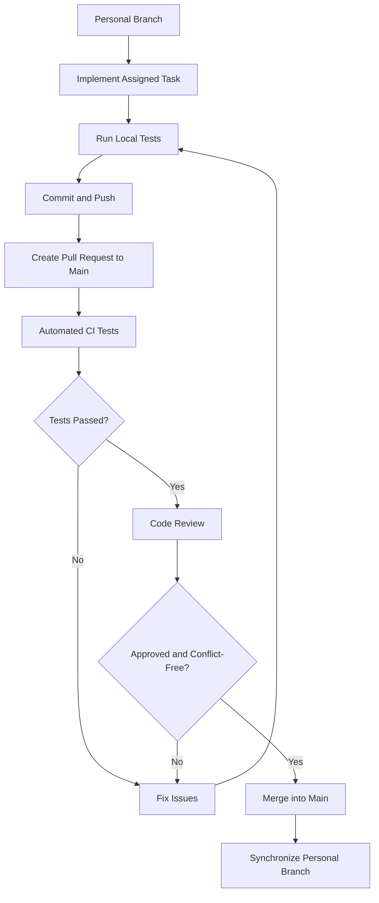

# S.O.S. — Self-Optimizing Survival Game

**Learn. Adapt. Survive.**


## 1. Project Overview

S.O.S. (Self-Optimizing Survival) is a custom 2D survival game powered by Reinforcement Learning.

The game features an autonomous robot that must navigate a challenging environment, avoid obstacles and hazards, collect batteries, and reach a safe destination while maximizing its cumulative reward.

The project investigates how different Reinforcement Learning algorithms learn, optimize their decisions, and perform within the same environment.

## 2. Project Objectives

- Design and implement a custom 2D game environment.
- Formulate the game as a Markov Decision Process (MDP).
- Implement three Reinforcement Learning algorithms from scratch.
- Train and evaluate agents under consistent environmental conditions.
- Compare algorithm performance, convergence, and learning efficiency.
- Visualize agent behavior and experimental results.
- Maintain a collaborative, tested, and documented codebase.

## 3. Game Environment

The proposed environment is a 7×7 grid-based survival game.

The robot interacts with the environment through four possible actions:

- Move left.
- Move down.
- Move right.
- Move up.

### Environment Components

| Component | Description |
|---|---|
| Robot | The learning agent navigating the environment |
| Empty Cell | A traversable position |
| Wall | An obstacle that blocks movement |
| Hazard | A dangerous cell that penalizes the agent |
| Battery | A collectible that provides a positive reward |
| Safe Exit | The final destination and terminal goal |

### Proposed Reward System

| Event | Reward |
|---|---:|
| Reaching the safe exit | +100 |
| Collecting a new battery | +15 |
| Entering a hazard | -20 |
| Invalid movement or collision | -5 |
| Normal movement | -1 |

The reward system encourages the agent to reach the safe exit efficiently while collecting useful resources and avoiding dangerous locations.

## 4. Reinforcement Learning Algorithms

Three Reinforcement Learning approaches will be implemented from scratch and evaluated using the same game environment.

| Algorithm | Category | Learning Approach |
|---|---|---|
| Policy Iteration | Dynamic Programming | Model-based |
| Q-Learning | Temporal Difference Learning | Model-free, value-based |
| REINFORCE | Policy Gradient | Model-free, policy-based |

### Policy Iteration

Policy Iteration finds an optimal policy through repeated policy evaluation and policy improvement using the known environment transition model.

### Q-Learning

Q-Learning learns optimal action values through interaction with the environment using temporal difference updates and an exploration strategy.

### REINFORCE

REINFORCE directly optimizes a parameterized policy using gradients estimated from complete episode returns.

## 5. Evaluation Metrics

The algorithms will be compared using:

- Average cumulative reward.
- Success rate.
- Average episode length.
- Convergence behavior.
- Training or planning time.
- Learning efficiency.
- Performance variability across independent runs.

Evaluation episodes will be separated from training and model selection.

Experimental results will be presented through comparative tables, learning curves, policy visualizations, and performance plots.

## 6. Technologies and Tools

| Technology | Purpose |
|---|---|
| Python 3.11 | Core programming language |
| NumPy | Numerical computations and RL implementations |
| Gymnasium | Environment interface |
| Pygame | Game visualization |
| Matplotlib | Experimental plots and visualizations |
| Pandas | Experimental data processing |
| Pytest | Automated testing |
| Git | Version control |
| GitHub | Team collaboration |
| GitHub Actions | Continuous Integration and automated testing |

## 7. Project Structure

```text
SOS-Self-Optimizing-Survival-Game/
│
├── .github/
│   ├── workflows/
│   │   └── tests.yml
│   ├── ISSUE_TEMPLATE/
│   │   └── task.md
│   └── pull_request_template.md
│
├── environment/
│   ├── __init__.py
│   ├── gridworld.py
│   ├── maps.py
│   ├── mdp.py
│   ├── state_encoder.py
│   └── visualization.py
│
├── agents/
│   ├── __init__.py
│   ├── base_agent.py
│   ├── policy_iteration.py
│   ├── q_learning.py
│   └── reinforce.py
│
├── training/
│   ├── __init__.py
│   └── train.py
│
├── evaluation/
│   ├── __init__.py
│   ├── evaluate.py
│   ├── metrics.py
│   └── plots.py
│
├── experiments/
│   ├── __init__.py
│   └── run_experiments.py
│
├── results/
│   ├── training_logs/
│   ├── evaluation_logs/
│   ├── metrics/
│   ├── figures/
│   └── models/
│
├── assets/
│   └── images/
│
├── tests/
│   ├── conftest.py
│   ├── test_setup.py
│   ├── test_environment.py
│   ├── test_state_encoder.py
│   ├── test_mdp.py
│   ├── test_policy_iteration.py
│   ├── test_q_learning.py
│   ├── test_reinforce.py
│   ├── test_training.py
│   ├── test_evaluation.py
│   ├── test_visualization.py
│   └── test_integration.py
│
├── docs/
│   ├── environment_design.md
│   ├── algorithm_design.md
│   ├── interfaces.md
│   ├── experiment_protocol.md
│   ├── diagrams/
│   ├── report/
│   └── presentation/
│
├── config.py
├── main.py
├── requirements.txt
├── pytest.ini
├── CONTRIBUTIONS.md
├── CONTRIBUTING.md
├── README.md
└── .gitignore
```

## 8. Installation and Setup

### Clone the Repository

```bash
git clone https://github.com/MennaAbdoo/SOS-Self-Optimizing-Survival-Game.git
cd SOS-Self-Optimizing-Survival-Game
```

Access to the private repository requires an accepted collaborator invitation.

### Create a Virtual Environment

```bash
python -m venv .venv
```

### Activate the Virtual Environment

Windows PowerShell:

```powershell
.\.venv\Scripts\Activate.ps1
```

Linux or macOS:

```bash
source .venv/bin/activate
```

### Install Dependencies

```bash
python -m pip install --upgrade pip
python -m pip install -r requirements.txt
```

### Run Automated Tests

```bash
python -m pytest -v
```

### Run the Game

The planned application entry point is:

```bash
python main.py
```

Game execution and training commands will be available after the corresponding modules are implemented.

## 9. Team Members and Personal Branches

Each team member has a dedicated personal branch for development.

| ID | Team Member | Personal Branch |
|---|---|---|
| S01 | Menna Abdo | `menna-abdo` |
| S02 | Maryam | `maryam` |
| S03 | Mennatullah | `mennatullah` |
| S04 | Menna Osama | `menna-osama` |
| S05 | Catherine | `catherine` |

### Branching Structure

```text
main
├── menna-abdo
├── maryam
├── mennatullah
├── menna-osama
└── catherine
```

The `main` branch represents the stable and integrated version of the project.

Personal branches are maintained throughout the project and should not be deleted after merging.

## 10. Development Workflow

All team members must follow the agreed development workflow.



### Start Working on Your Branch

Replace `YOUR-BRANCH` with your assigned personal branch.

```bash
git fetch origin
git switch YOUR-BRANCH
git pull origin YOUR-BRANCH
git merge origin/main
```

### Commit and Push Changes

After implementing your assigned task:

```bash
python -m pytest -v
git status
git add <changed-files>
git commit -m "Describe the implemented task"
git push origin YOUR-BRANCH
```

### Create a Pull Request

On GitHub, create a Pull Request using:

- Base branch: `main`
- Compare branch: your personal branch

Every Pull Request must include a clear description of the changes, related tasks, and testing results.

### Merge Requirements

The team follows these requirements before merging:

- All automated tests must pass.
- At least one other team member must approve the Pull Request.
- All merge conflicts must be resolved.
- All review comments must be addressed.
- Relevant documentation and contribution records must be updated.

Direct pushes to `main` are not allowed during team development.

### Synchronize After Merging

```bash
git fetch origin
git switch YOUR-BRANCH
git merge origin/main
git push origin YOUR-BRANCH
```

## 11. Continuous Integration and Testing

GitHub Actions is used to automatically validate the project.

The testing workflow is configured to run when:

- Changes are pushed to any personal branch.
- A Pull Request targets `main`.
- Changes are pushed or merged into `main`.

### Testing Strategy

| Testing Category | Purpose |
|---|---|
| Setup Testing | Verify dependencies and package imports |
| Environment Testing | Validate movement, rewards, obstacles, and termination |
| State Encoding Testing | Verify state representation and conversion |
| MDP Testing | Validate transition probabilities and rewards |
| Algorithm Testing | Verify learning and policy update rules |
| Training Testing | Validate the training pipeline |
| Evaluation Testing | Verify metrics and evaluation behavior |
| Visualization Testing | Validate game rendering |
| Integration Testing | Verify interaction between project components |

Functional tests will be added alongside the implementation of each component.

## 12. Project Documentation

| Document | Description |
|---|---|
| [Environment Design](docs/environment_design.md) | Game rules, states, actions, rewards, and transitions |
| [Algorithm Design](docs/algorithm_design.md) | Reinforcement Learning algorithm designs |
| [System Interfaces](docs/interfaces.md) | Shared interfaces and integration requirements |
| [Experiment Protocol](docs/experiment_protocol.md) | Training and evaluation methodology |
| [Contributing Guidelines](CONTRIBUTING.md) | Development workflow and collaboration rules |
| [Team Contributions](CONTRIBUTIONS.md) | Individual contributions and review records |

## 13. Project Roadmap

- [x] Create GitHub repository.
- [x] Establish project directory structure.
- [x] Configure Python virtual environment.
- [x] Install project dependencies.
- [x] Configure Pytest.
- [x] Pass initial setup tests.
- [x] Configure initial GitHub Actions workflow.
- [x] Create personal branches.
- [ ] Finalize CI configuration for personal branches.
- [ ] Invite all team members.
- [ ] Configure main branch protection.
- [ ] Finalize game environment design.
- [ ] Define shared system interfaces.
- [ ] Implement game environment.
- [ ] Implement Policy Iteration.
- [ ] Implement Q-Learning.
- [ ] Implement REINFORCE.
- [ ] Implement training pipeline.
- [ ] Implement evaluation pipeline.
- [ ] Implement game visualization.
- [ ] Complete functional and integration testing.
- [ ] Conduct comparative experiments.
- [ ] Analyze and visualize experimental results.
- [ ] Complete final project report.
- [ ] Prepare final presentation and demonstration.

## 14. Academic Information

| Information | Details |
|---|---|
| University | Alamein International University |
| Course | Advanced Machine Learning |
| Course Code | AIE322 |
| Semester | Fall 2026 |
| Project Type | Reinforcement Learning Game |
| Team Size | 5 Members |

## 15. Project Status

**Under Development**

The repository structure, development environment, personal branches, and initial testing infrastructure have been established.

Game implementation, Reinforcement Learning algorithms, functional testing, and experimental evaluation will be completed collaboratively throughout the project.

---

**S.O.S. — Self-Optimizing Survival**

*Learn. Adapt. Survive.*