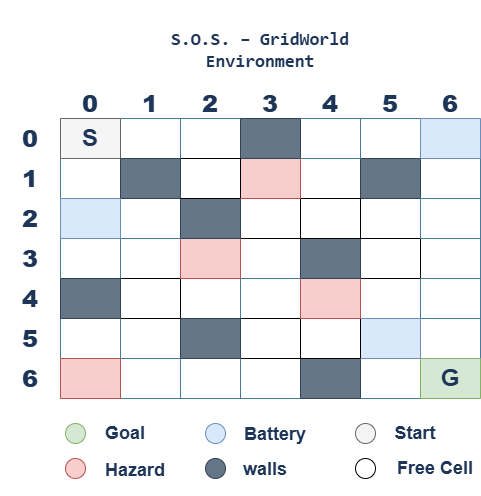
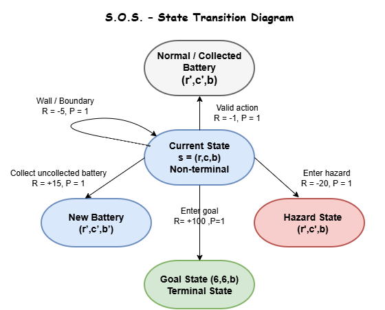
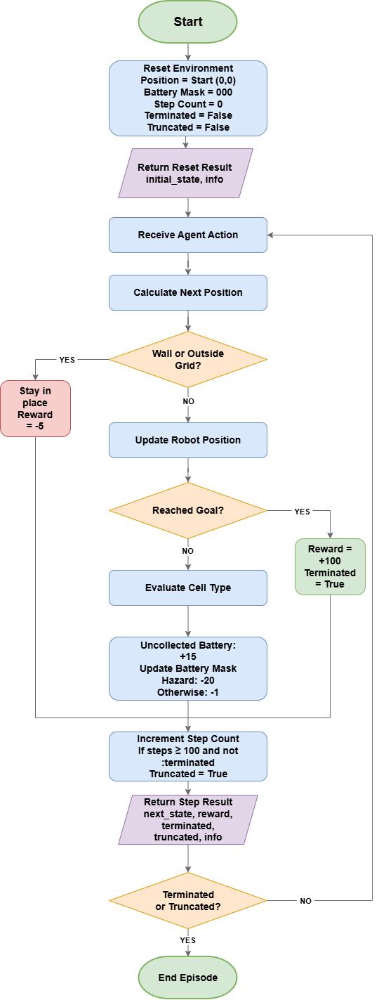

# S.O.S. — Environment Design

## 1. Game Overview

S.O.S. is a 2D GridWorld game in which a robot learns to reach a safe destination, avoid obstacles and hazards, and collect optional batteries while maximizing its cumulative reward.

The same environment is used to compare Policy Iteration, Q-Learning, and REINFORCE.

## 2. Environment Layout

The environment is a fixed 7 × 7 grid.

| Element | Coordinates |
|---|---|
| Start | (0,0) |
| Goal | (6,6) |
| Batteries | (0,6), (2,0), (5,5) |
| Hazards | (1,3), (3,2), (4,4), (6,0) |
| Walls | (0,3), (1,1), (1,5), (2,2), (3,4), (4,0), (5,2), (6,4) |

## 3. State Space

The state is represented as:

`s = (row, column, battery_mask)`

The battery mask contains three binary flags indicating whether each battery has been collected.

- Initial state: `(0, 0, 000)`
- Battery mask: `4 × b1 + 2 × b2 + b3`
- Allocated state IDs: `7 × 7 × 8 = 392`
- State encoding: `state_id = (row × 7 + column) × 8 + battery_mask`

Wall states and unreachable states are excluded from actual gameplay.

## 4. Action Space

| ID | Action | Movement |
|---|---|---|
| 0 | LEFT | (0,-1) |
| 1 | DOWN | (+1,0) |
| 2 | RIGHT | (0,+1) |
| 3 | UP | (-1,0) |

## 5. Reward Function

| Event | Reward |
|---|---:|
| Reach goal | +100 |
| Collect new battery | +15 |
| Enter hazard | -20 |
| Wall or boundary collision | -5 |
| Normal movement or collected battery | -1 |

Only one reward is assigned per step.

## 6. Transition Model

The environment is deterministic, meaning each state-action pair has one possible outcome with probability 1.

- Valid movement updates the robot's position.
- Collisions keep the robot in its current state.
- Collecting a new battery updates the battery mask.
- Hazards apply a penalty without ending the episode.
- Reaching the goal terminates the episode.

## 7. Episode Rules

- Each episode starts at (0,0) with all batteries uncollected.
- Reaching the goal sets `terminated = True`.
- Reaching 100 steps without reaching the goal sets `truncated = True`.
- Every action attempt counts as one step.
- Goal termination takes precedence over truncation.
- Collecting all batteries is optional.

## 8. Environment Workflow

## 9. Environment Interface

- `reset(seed=None)` → `state, info`
- `step(action)` → `next_state, reward, terminated, truncated, info`
- `render()` → Visualize the environment.
- `close()` → Release visualization resources.

Detailed interface contracts are defined in `docs/interfaces.md`.

## 10. Assumptions and Shared Constraints

- Fixed map and starting position.
- Static walls and hazards.
- Batteries provide rewards only and can be collected once per episode.
- Shared discount factor: `gamma = 0.9`.
- The 100-step limit is external to the underlying MDP.
- All algorithms must use identical states, actions, rewards, and transition rules.
- Rendering is disabled during training and performance measurements.
- Environment changes require team agreement.